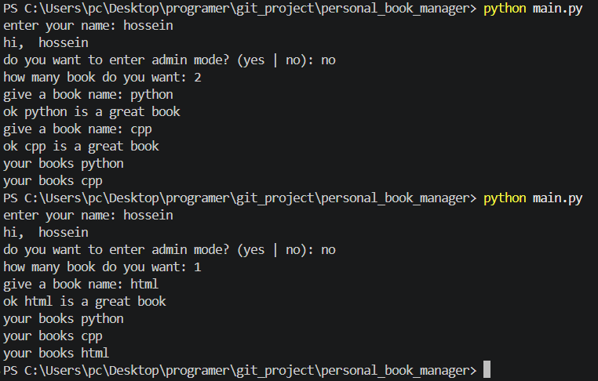
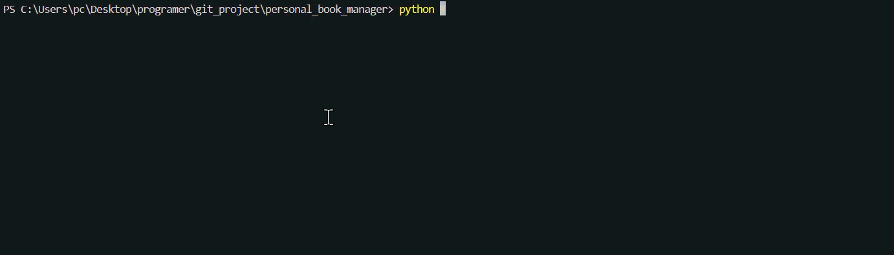

# Personal Book Manager


A Simple personal book manager built with Python.

## Table of Contents

* [Features](#features)
* [Project Structure](#project-structure)
* [How It Works](#how-it-works)
* [Requirements](#requirements)
* [Installation](#installation)
* [Environment Setup](#environment-setup)
* [Usage](#usage)
* [Troubleshooting](#troubleshooting)
* [Example Output](#example-output)
* [Screenshot](#screenshot)
* [Demo](#demo)
* [Roadmap](#roadmap)
* [Contributing](#contributing)
* [License](#license)
* [Author](#author)

## Features

* Book Management System
  * Asks the user to enter books
  * Manages and displays the list of books
  * Loads existing books automatically

* Books Storage
  * Saves books data in JSON format

* Admin Mode
  * Asks for the admin password
  * Keeps private information outside the main Python file
  * Loads the password from `.env` (`ADMIN_ENTRY_PASSWPRD`)


* Book Priority
  * after every book that you pick and say you have to pick a priority beetween this three options:
  * high
  * medium
  * low
## Project Structure

Here is an overview of the key files and directories in this repository:

* `main.py`: The main entry point of the project. It handles user welcome messages, asks for Admin Mode, validates credentials, and controls the execution flow.
* `books.py`: Contains the core logic for the application, including functions to ask for books, display book collections, and load/save records.
* `.env.example`: A template showing the required environment variables without exposing sensitive secrets.
* `.gitignore`: Prevents sensitive and temporary files (such as local `.env` and `__pycache__/`) from being tracked or pushed to Git.
* `requirements.txt`: Specifies dependencies needed to run the project, specifically `python-dotenv`.
* `pictures/`: Stores screenshots and visual demonstrations used in the documentation.
* `gifs/`: Stores demo GIFs showcasing the program features.
* `README.md`: Provides comprehensive instructions and guides on running and troubleshooting the project.

## How It Works

The program executes in a simple and structured CLI workflow:

1. **User Welcome:** When you run `main.py`, it prompts you for your name (`enter your name:`) and displays a personalized greeting (`hi, <name>`).
2. **Admin Mode Option:** The program asks if you want to switch to Admin Mode (`yes | no`).
3. **Password Verification:** 
   * If you choose `yes`, it prompts for the password (`enter the password:`). It reads your admin password from the `.env` file via `dotenv` and compares it. If valid, you receive access (`welcome admin!!`).
4. **Data Handling & Inputs:**
   * It checks for existing entries and prompts the user for the count of new books (`how many book do you want:`).
   * It takes each title one by one and confirms with feedback (`ok <book_name> is a great book`).
5. **Display & Persistence:** It outputs the complete list of books (`your books <book_name>`) and preserves the records in JSON format for the next session.

## Requirements

Before running the project, make sure you have:

* `Python 3`
* `python-dotenv`

## Installation

1. Open a terminal in the project folder.

2. Check that Python is installed:
```bash
python --version
```

3. Install the Python packages:
```bash
pip install -r requirements.txt
```

## Environment Setup

1. Create a `.env` file from `.env.example`:
```bash
cp .env.example .env
```

2. Open the new `.env` file.

3. Replace the example value with your admin password:
```text
ADMIN_ENTRY_PASSWPRD=your_password_here
```

4. Save the file.

> Do not commit your `.env` file because it may contain private information.

## Usage

1. Open a terminal in the project folder.

2. Run the book manager:
```bash
python main.py
```

3. Enter your name.

4. Choose `yes` or `no` for admin mode.

5. If you choose `yes`, enter the password from your `.env` file.

6. Add or view your books.

## Troubleshooting

Here are 4 common issues you might face when running the project, along with their causes and first checks:

### 1. `FileNotFoundError`
* **What it means:** Python cannot find an expected file during execution (e.g., `books.json` or `.env`).
* **Why it happens:** The file has not been created yet, was saved under a different folder, or the script was launched from a different working directory.
* **First thing to check:** Ensure your terminal's current directory is the root of the project folder, and verify that the target file actually exists there.

### 2. `JSONDecodeError`
* **What it means:** The JSON parser failed to interpret the data stored inside `books.json`.
* **Why it happens:** The `books.json` file is completely empty or has invalid JSON syntax caused by manual edits (such as a missing closing bracket `]` or trailing comma).
* **First thing to check:** Open `books.json` in your code editor and check whether it contains valid JSON (e.g. `[]` for an empty list) or if it has any red syntax warnings.

### 3. Missing `python-dotenv` (`ModuleNotFoundError`)
* **What it means:** Python throws `No module named 'dotenv'` when attempting to load environment variables.
* **Why it happens:** The package is not installed in the currently active Python interpreter or virtual environment.
* **First thing to check:** Run `pip install -r requirements.txt` or `pip list` in your terminal to ensure `python-dotenv` is installed for the Python version you are running.

### 4. Admin Password Not Loading from `.env`
* **What it means:** The password entered is rejected even when typing the correct value, or the program reads `None` as the password.
* **Why it happens:** The `.env` file is missing, located in a parent/sub-directory, or the key name has a typo (note that the template uses `ADMIN_ENTRY_PASSWPRD` with a 'P' instead of 'O').
* **First thing to check:** Verify that the key name in your local `.env` exactly matches what is used in the code (`ADMIN_ENTRY_PASSWPRD`) and make sure `load_dotenv()` is called before reading the variable.

## Example Output
### Admin mode

```text
enter your name: hossein
hi,  hossein
do you want to enter admin mode? (yes | no): yes
enter the password: ********
admin mode activated
```
### Regular User
```text
enter your name: hossein
hi,  hossein
do you want to enter admin mode? (yes | no): no
how many book do you want: 2
give a book name: python
ok python is a great book
give a book name: cpp
ok cpp is a great book
your books python
your books cpp
```

## Screenshot

### Program Execution



## Demo



## Roadmap

* [x] Ask for user name
* [x] Add admin mode authentication
* [x] Load and manage book list
* [x] Save books into JSON file
* [x] Add priority 
* [ ] Add search by book title
* [ ] Add delete book option

## Contributing

## License

## Author

Created by [Hossein Shamani](https://github.com/hossein-shamani-92)
